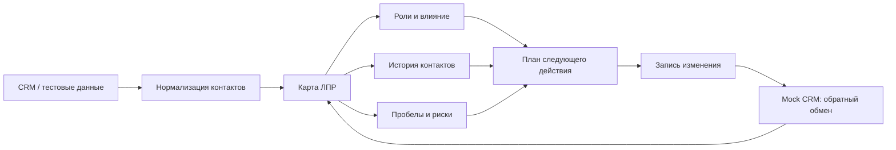

# Sammi × КРОК — бизнес-анализ решения «Алло, бизнес»

**Версия:** 1.0 · **Дата:** 16.11.2026 · **Статус:** продуктовая гипотеза и техническое задание к MVP, а не описание уже внедрённой CRM.

**Основные источники:**
1. Приложенный организаторами PDF «Алло, бизнес: интерактивная карта контактов клиентов», 4 страницы — постановка кейса.
2. Репозиторий Sammi: <https://github.com/ArduRadioKot/sammi>, [README.md](https://github.com/ArduRadioKot/sammi/blob/main/README.md), [PROJECT_MAP.md](https://github.com/ArduRadioKot/sammi/blob/main/PROJECT_MAP.md), [SKILL-feelistic-aries.md](https://github.com/ArduRadioKot/sammi/blob/main/SKILL-feelistic-aries.md) — подтверждённая документация продукта.

> **Граница достоверности.** Требования КРОК взяты из кейса; сведения о Sammi — из доступной документации репозитория, не из полноценного локального аудита всех исходников. Метрики, целевые значения, модель данных, UX и оценка ценности ниже — **проектные предложения** команды, их необходимо валидировать с представителями КРОК. Выделенные в примерах числа не являются результатами исследований КРОК.

---

## 1. Executive summary

**Проблема.** В крупных B2B-продажах покупку определяет не один контакт, а сеть сотрудников: ЛПР, влияющие лица, пользователи, закупки, ИБ, финансисты и бизнес-заказчики. Знания о них распределены между CRM, календарями, письмами, файлами и памятью менеджеров. Список контактов не показывает реальные механизмы принятия решения и пробелы взаимодействия.

**Продукт.** Новый модуль **«Карта ЛПР»** внутри Sammi, доступный из карточки клиента. Он агрегирует контактные данные, роли, влияние, связи, историю коммуникаций и позволяет планировать следующий шаг по аккаунту. **Отличие от оргструктуры:** для каждой связи указывается её смысл, а для каждой оценки — источник и актуальность.

**Результат для бизнеса:** уменьшение времени подготовки к встречам, снижение риска зависимости от одного контакта, повышение полноты карты влияния, меньше потерь знаний при смене менеджеров, единый контекст для продаж/маркетинга/проектных команд. Увеличение конверсии сделок — стратегическая гипотеза, которую MVP сам по себе не доказывает.

**Критический путь:** (1) CRM-данные и роли → (2) интерактивный граф + карточки людей → (3) история, оценки, редактирование и фильтры → (4) обмен с mock CRM → (5) аналитика и AI. Защита должна демонстрировать полный путь от «потерянного ЛПР» к конкретному действию, а не только красивую визуализацию.

## 2. Контекст и ограничения кейса

### 2.1. Семь обязательных функций КРОК

| ID | Требование из кейса | Что считаем выполнением |
|---|---|---|
| R1 | Выбор клиента | Можно выбрать ≥2 компании и переключать граф без смешения данных. |
| R2 | Карта людей | Интерактивное отображение сотрудников, ролей и подразделений клиента. |
| R3 | Связи между людьми | Типизированные связи, не только «начальник → подчинённый». |
| R4 | Оценка отношений | Состояние/сила/характер отношения поставщика к человеку и фактическая дата оценки. |
| R5 | История взаимодействий | Хронология событий контакта с автором, каналом и датой. |
| R6 | Редактирование | Пользователь меняет карточки, связи, оценки/взаимодействия; данные сохраняются. |
| R7 | Фильтрация карты | Подразделение, роль в решении, уровень влияния, качество отношений, свежесть данных. |

Дополнительные направления по кейсу: AI-помощник, автоматическое обновление, совместная работа, аналитика. **Реальная CRM и боевые данные не предоставляются**: допустимы обезличенные данные и mock API. Необходима демонстрация входящих CRM-данных, собственных данных карты и обратной передачи результатов в CRM.

### 2.2. Что можно переиспользовать из Sammi (подтверждено README/PROJECT_MAP)

- Frontend: React 19, TypeScript, Vite, React Router, маршруты `/app`, `/app/tables`, `/app/people`, `/app/companies`; сервисный слой `src/services/` (но пути отдельных модулей нужно проверить в локальном дереве).
- Backend: FastAPI в `apps/api/`, PostgreSQL/SQLAlchemy/Alembic; JWT в beta-режиме, workspace membership и базовые роли.
- Табличная сущность `table` с `object_type=company|person|custom`, columns и rows в JSONB; API CRUD, CSV import/export, сохранение изменений.
- Работа с DaData для обогащения данных **компаний**, отдельная географическая карта контактов (`GET /api/v1/tables/{table_id}/map`, Nominatim). **Ни то, ни другое не является картой ЛПР.**
- AI registry (Ollama, Yandex AI, GigaChat), но бизнес-аналитика отношений не заявлена как готовая функция; CRM явно обозначена в README как не реализованная.
- Дизайн-система: `src/styles/tokens.css`, `src/lib/motion/tokens.ts`, `SKILL-feelistic-aries.md`: приложение — warm ivory, teal для действий; тёмная emerald-тема, Instrument Sans; не ломать существующий стиль.

**Практический вывод:** не переписывать Tables/CSV/auth. Добавить самостоятельные бизнес-сущности и визуальный модуль. Не рассчитывать на то, что произвольные строки JSONB уже обеспечивают предметную модель отношений.

## 3. Stakeholder map и задачи пользователей

| Участник | Job-to-be-done | Задача / боль | Что видит в MVP |
|---|---|---|---|
| Account Manager / продажи | Подготовиться к встрече и расширить контактную сеть | Неясно, кто влияет и кого ещё не знаем | Граф, оценка влияния, пробелы и следующий шаг |
| Руководитель продаж | Снизить риск «всё держится на одном человеке» | Не видит качество покрытия клиента | Охват, зависимость, свежесть отношений |
| Маркетинг | Персонализировать взаимодействие | Нет понимания интересов и полномочий | Роли, интересы, сегменты, допустимые коммуникации |
| PM / delivery | Передавать знания об участниках проектов | Контекст остаётся в отдельных командах | История, участие в проектах и обратная связь |
| Архитектор / пресейл | Найти технических экспертов | Не знает, у кого валидировать требования | Технические роли и связи |
| CRM-администратор | Управлять источником истины и правами | Дубли, конфликтные записи, отсутствие контроля | Синхронизация, происхождение данных, журнал изменений |

**Нельзя** выводить из должности человека реальную власть, поддержку сделки или его отношение к поставщику без источника. Должность ≠ роль в конкретной закупке.

## 4. AS-IS → TO-BE

### AS-IS, по описанию кейса
1. Контакты хранятся карточками в CRM, отдельные данные — в письмах, календарях, комментариях, презентациях и памяти команды.
2. Менеджер перед встречей собирает контекст вручную.
3. Структура клиента иногда рисуется в презентации, быстро устаревает и не синхронизируется.
4. Разные команды независимо обращаются к одним людям; важные участники решения остаются без контакта.
5. При увольнении сотрудника часть контекста отношений теряется.

### TO-BE, предлагаемый процесс

**Business outcomes**: знание о клиенте фиксируется и доступно уполномоченной команде; менеджер видит не только факты, но и пробелы; каждая важная оценка привязана ко времени и источнику; изменения не остаются в «ручной картинке».

## 5. Ключевые бизнес-вопросы продукта

1. Кто является ЛПР, влияющим лицом, пользователем, инициатором, блокирующей стороной и экспертом **для выбранной инициативы/сделки**?
2. Через какие существующие профессиональные отношения можно выйти на человека? **Только через подтверждённые связи, без предположений о личных знакомствах.**
3. Какие подразделения и роли из контрольного списка не покрыты контактами?
4. В каких ролях слишком многое зависит от одного человека? Что произойдёт при его уходе?
5. С какими ключевыми контактами не было общения N дней?
6. Кто и когда оценил влияние/отношение человека? На чём основана оценка?
7. Как изменилась карта по сравнению с прошлой неделей/месяцем?
8. Какие записи готовы к обратной передаче в CRM, а какие требуют проверки?

## 6. User journeys и сценарии демонстрации

### UC-01 — найти ключевого участника сделки (P0)
**Актор:** account manager. **Старт:** открыт клиент. **Шаги:** выбрать компанию → включить «Влияние на решение» → отфильтровать роль ЛПР/высокое влияние → выбрать узел → посмотреть карточку, источник и историю. **Результат:** менеджер знает, кто важен и насколько достоверна информация. **Исключение:** роль неизвестна — UI показывает «Не подтверждено», а не придумывает значение.

### UC-02 — найти пробел в покрытии (P0/P1)
**Актор:** менеджер/руководитель. **Шаги:** открыть «Покрытие» → увидеть ИБ без подтверждённых активных контактов → открыть список людей → создать задачу на знакомство/отметить следующий шаг. **Результат:** конкретный план действия.

### UC-03 — зафиксировать встречу (P0)
**Актор:** PM/менеджер. **Шаги:** выбрать человека → «Добавить взаимодействие» → заполнить дату, тип, краткое содержание, автора → сохранить → увидеть событие в ленте и обновлённую дату контакта. **Исключение:** сервер отклонил запись — данные не отображаются как сохранённые.

### UC-04 — обновить отношение и влияние (P0)
**Актор:** менеджер. **Шаги:** изменить оценку отношения и влияния с комментарием, источником, датой → сохранить → получить новую визуализацию. **Результат:** прозрачная субъективная оценка, не выдаваемая за объективный факт.

### UC-05 — найти путь знакомства (P1)
**Актор:** менеджер. **Шаги:** выбрать целевого ЛПР → запустить поиск пути по **разрешённым подтверждённым связям** → получить цепочку и список ограничений. **Исключение:** путь не найден — UI честно сообщает «Нет подтверждённого пути».

### UC-06 — синхронизация с CRM (P0 для демонстрации концепции)
**Актор:** администратор/менеджер. **Шаги:** загрузка mock CRM → изменения на карте → просмотр исходящих событий → применение в mock CRM → повторная загрузка. **Результат:** убедительная двусторонняя схема и отсутствие «фальшивой» интеграции.

## 7. Предметная модель данных (предложение, не существующая схема Sammi)

### 7.1. Основные сущности

| Entity | Существенные поля | Примечание |
|---|---|---|
| `accounts` | id, workspace_id, crm_external_id, name, industry, owner_id, updated_at | Корпоративный клиент |
| `contacts` | id, account_id, crm_external_id, full_name, title, department_id, contact_status, updated_at | Контакт; не хранить лишние ПД в демо |
| `departments` | id, account_id, name, parent_id | Подразделения |
| `initiatives` | id, account_id, name, status, owner_id | Сделка/инициатива для контекстных ролей |
| `stakeholder_roles` | contact_id, initiative_id, role, influence_level, confidence, source | Роль человека может отличаться по сделкам |
| `relationships` | id, account_id, source_contact_id, target_contact_id, type, direction, strength, confidence, evidence, verified_at | Тип и направление связи обязательны |
| `engagement_assessments` | id, contact_id, initiative_id?, stance, relationship_strength, evaluated_by, evaluated_at, evidence | «Поддерживает», «нейтрально», «скептически», «неизвестно» |
| `interactions` | id, account_id, contact_ids, occurred_at, type, summary, author_id, visibility, source | Встреча/звонок/письмо/событие, у одной встречи может быть несколько участников |
| `sync_events` | id, account_id, direction, entity_type, entity_id, state, created_at, error | Для mock CRM и будущей интеграции |
| `audit_events` | id, actor_id, action, entity_type, entity_id, occurred_at, before_after | Для прослеживаемости изменений |

**Инварианты:** у контактов одной карты один account; при межклиентских связях отдельная явная модель; связь одного сотрудника с самим собой недопустима, если нет особого business-type; не дублировать одинаковые рёбра; отделять объективные данные CRM от оценок продавцов; учитывается workspace isolation.

### 7.2. Источники истины и синхронизация

| Поле | Источник истины для MVP | Куда передаётся |
|---|---|---|
| Имя, должность, подразделение | Mock CRM (входящий снимок) | Только по явному правилу обновления |
| Связи влияния и знакомства | Sammi / карта ЛПР | Outbox/event к mock CRM (если CRM принимает такие поля) |
| Оценки отношений и комментарии | Sammi | Outbox/event или заметка CRM |
| История взаимодействий | CRM + локально добавленные события | По external_id с дедупликацией |
| Вычисленные метрики | Analytics service | Не писать в CRM как установленные факты |

Предлагаемый контракт: `GET /api/v1/accounts`, `GET /api/v1/accounts/{id}/stakeholders`, `GET /api/v1/accounts/{id}/relationships`, `GET /api/v1/accounts/{id}/interactions`, CRUD для каждой сущности, `POST /api/v1/accounts/{id}/crm-sync/preview`, `POST /api/v1/accounts/{id}/crm-sync/commit`. **Это новые проектные endpoints**, они отсутствуют в подтверждённом списке текущих API Sammi.

Для защиты допустим адаптер, читающий тестовую базу/фикстуры и показывающий «что пришло из CRM / что изменено в Sammi / что будет отправлено обратно». Не обозначать mock как реальное подключение.

## 8. Прикладная аналитика: метрики и формулы

**Требование к любой аналитике:** показывать используемый набор контактов, период наблюдения, определение «активного» контакта, размер выборки и предупреждение о неизвестных данных.

| KPI | Определение / расчёт | Практический смысл |
|---|---|---|
| Покрытие критических ролей | `число критических ролей с ≥1 подтверждённым доступным контактом / число требуемых ролей` | Есть ли доступ к комитету сделки |
| Покрытие подразделений | `отделы с ≥1 активным контактом / целевые отделы` | Где «белые пятна» |
| Свежесть коммуникаций | `ключевые контакты со взаимодействием за N дней / все ключевые контакты` | Кто давно не в коммуникации |
| Среднее время с последнего контакта | Среднее `today − last_interaction_at` по контактам с историей | Риск устаревания отношений; «нет данных» отдельно |
| Уровень зависимости от одного человека | `max(число значимых путей через одного контакта) / число значимых путей` — только если пути определены | Концентрация отношений (эвристика) |
| Доля подтверждённых связей | `verified relationships / all relationships` | Насколько граф опирается на факты |
| Completeness контактов | Доля заполненных обязательных полей по контекстной схеме | Качество CRM-снимка |
| Action completion rate | `выполненные рекомендованные действия / принятые в работу действия` | Польза от карты, а не от просмотра |
| Time to prepare (пользовательское) | Медиана минут на подготовку к встрече по измеренному сценарию | Проверяемая экономия времени |

### 8.1. Индикатор риска: не «AI знает», а объяснимые правила

Предлагаемая система сигналов:
- **Пробел:** у критической роли нет подтверждённого активного контакта.
- **Устаревание:** у важного человека отсутствует взаимодействие > N дней (N настраивается, по умолчанию 60 лишь для демо).
- **Высокая зависимость:** у компании значимая часть документированных контактов проходит через одного внутреннего account-owner или одного представителя клиента.
- **Низкая уверенность:** доля непроверенных связей/ролей высокая.

Для каждой карточки риска выводить **«Почему?»** → список конкретных фактов, ссылки на карточки и дату расчёта. Не превращать эвристический «риск» в утверждение о намерениях человека.

### 8.2. Показатели эффективности MVP и цели пилота

В исходных материалах нет исторического baseline КРОК; ниже — **предлагаемые гипотезы для проверки**, не фактические результаты:

| Гипотеза | Метод измерения | Предлагаемый порог MVP |
|---|---|---|
| Ускорение подготовки к встрече | Один и тот же сценарий без карты и с картой, медиана по участникам | ≥25% быстрее |
| Полнота структурированных сведений | До/после заполнения карты на обезличенном кейсе | +20 п.п. заполненных обязательных полей |
| Время нахождения «забытого» ЛПР | Таймер на пользовательском задании | ≤60 секунд |
| Скорость внесения взаимодействия | Таймер от выбора контакта до подтверждённого сохранения | ≤45 секунд |
| Прозрачность аналитики | Доля рисков с объяснением и ссылкой на запись | 100% |
| Функциональная полнота | Acceptance checklist из раздела 10 | 7/7 обязательных функций |

### 8.3. Экономическая оценка — только сценарная

Для полноценного business case нужны реальные данные о размере команды продаж, числе аккаунтов, времени подготовки и стоимости часа. Без них нельзя обещать ROI.

Модель:

`Ежемесячная экономия = менеджеры × встречи/менеджер/месяц × экономия минут/встречу / 60 × стоимость часа`.

**Иллюстрация, не сведения КРОК:** 20 менеджеров × 16 встреч/мес × 15 минут экономии = **80 часов/мес**. При условной внутренней стоимости 2 000 ₽/час это **160 000 ₽/мес** высвобождаемого времени. Это не дополнительная выручка и не гарантированный денежный эффект. Далее отдельно учитываются стоимость поддержки, интеграции, обучения и качество данных.

## 9. Функциональные требования и приоритеты

| ID | Приоритет | Требование | Проверка |
|---|---|---|---|
| FR-01 | P0 | Список и выбор компаний; изоляция данных | A → B → A: набор людей и связей не смешивается |
| FR-02 | P0 | Граф с различимыми узлами/типами рёбер | Пользователь находит нужного ЛПР за ≤3 действия |
| FR-03 | P0 | Карточка человека с ролью, должностью, источником | По клику доступна информация и статус неизвестных значений |
| FR-04 | P0 | Добавление/правка/удаление связей | Сохранение, обновление графа, повторная загрузка |
| FR-05 | P0 | Оценка отношений и влияния с доказательством | Видно авторство и дату оценки |
| FR-06 | P0 | История взаимодействий и добавление записи | Новая запись появляется после успешного ответа API |
| FR-07 | P0 | Фильтры/поиск и сброс | Фильтрация работает по всей карте, не только viewport |
| FR-08 | P0 | Mock CRM + видимая модель обмена | Фиксируются входящие и исходящие изменения |
| FR-09 | P1 | Дашборд покрытия и рисков | Каждому риску соответствует объяснение |
| FR-10 | P1 | Поиск пути по подтверждённым связям | Вывод цепочки или честное «путь не найден» |
| FR-11 | P1 | Режимы оргструктуры / влияния | Никакой ложной идентичности понятий |
| FR-12 | P2 | AI-подсказки по следующему шагу | AI цитирует исходные записи, можно выключить |
| FR-13 | P2 | Автоматическая актуализация / временная шкала | Дата и источник изменений доступны |

### Non-functional requirements
- Responsive desktop-first, usable on планшете; смартфон даёт список+карточку вместо перегруженного полотна.
- Панорамирование и zoom не должны ломать чтение; таблица/список как альтернатива графу.
- Клавиатурная навигация, видимый focus, контраст, `prefers-reduced-motion`.
- Безопасная обработка строк, отсутствие секретов API и реальных ПД в тестовых фикстурах.
- Контроль ролей workspace (включая viewer read-only), отказ в доступе к чужому аккаунту.
- Сохранения и ошибки сети должны быть явными, без мнимого успеха.
- Наблюдаемость: request_id в ошибках, журнал синхронизации, минимальные технические логи без секретов.

## 10. Acceptance test: полная демонстрация в 6–8 минут

**Предусловия:** подготовлены 2–3 **вымышленные компании**, 20–40 контактов, несколько отделов, 30–60 связей разных типов, 15–30 событий взаимодействий. Тестовые данные должны показывать пробел в ИБ, сильную зависимость от одного человека, скептически настроенного участника и устаревшие записи. Все фикстуры маркированы «демонстрационные».

1. Открыть клиента А → карта. Переключить на B и обратно, показать отсутствие «утечки» данных.
2. Найти человека по должности/имени, открыть карточку, увидеть должность, влияние, отношение, источники.
3. Включить фильтр «ИБ» и слой «Влияние на решение», показать связи и «белое пятно».
4. Открыть карточку, добавить встречу; UI показывает pending → success и новое событие.
5. Изменить оценку отношения, перезагрузить страницу и подтвердить сохранение.
6. Создать новую связь и отфильтровать её по типу.
7. Открыть «CRM sync»: какие поля пришли из mock CRM, какие изменены в карте и что вернётся обратно.
8. Если готов P1 — показать путь к ЛПР и одну объяснённую метрику риска.

**Критерий Done для обязательного MVP:** функции R1–R7 работают без stub-кнопок и fake toast; есть объяснение обмена CRM, осмысленный сценарий и возможность запускать демо без конфиденциальных данных.

## 11. Риски и способы снижения

| Риск | Вероятность / влияние | Контрмера |
|---|---|---|
| «Красивый граф» без ценности | Высокая / высокая | Каждый экран отвечает на бизнес-вопрос; 1 сквозной сценарий |
| Путаница оргсвязей и влияния | Высокая / высокая | Разные категории рёбер и два отдельных режима |
| Ложная уверенность в AI | Средняя / высокая | Источники, unknown, ручное подтверждение |
| Отсутствие реального CRM | Факт из кейса / среднее | Mock API + честная демонстрация contract и sync событий |
| Слабые тестовые данные | Высокая / высокая | Сценарный датасет с проблемами и историей |
| Переписывание Sammi целиком | Средняя / высокая | Feature module поверх существующей оболочки и сервисного слоя |
| Конфликты при редактировании | Средняя / среднее | Явная дата изменения, обработка 409, затем optimistic locking |
| Персональные сведения | Средняя / высокая | Полностью вымышленные данные, workspace scopes, минимизация |
| Успеть AI раньше ядра | Высокая / высокая | Строгий порядок P0 → P1 → P2 |

## 12. План реализации (этапы без обещания сроков)

| Этап | Обязательный выход | Статус после этапа |
|---|---|---|
| 0. Контракт/фикстуры | Схемы entities, source-of-truth, 2–3 сценарных клиента | Можно реализовывать UI и API параллельно |
| 1. Карта | Селектор клиента, граф, карточки, типы связей, поиск/фильтры | R1, R2, R3, R7 |
| 2. Живая работа | Редактирование, отношения, история, сохранение и errors | R4, R5, R6 |
| 3. CRM & защитный сценарий | Mock CRM sync, demo seed, end-to-end сценарий | Требования конкурса по интеграции раскрыты |
| 4. Дифференциация | Покрытие, риски, поиск пути, AI по желанию | Дополнительная техническая ценность |

## 13. Open questions к КРОК и организаторам

1. Какая CRM, типы и форматы её контактов/активностей предполагаются в целевой системе?
2. Что считается «отношением»: контакт поставщик↔сотрудник, сотрудник↔сотрудник или оба вида? Как изменяются роли по сделкам?
3. Какие типы рёбер и ролей предпочитает бизнес? Кто имеет право их редактировать?
4. Как считать «важного человека» и «активный контакт»? Какие пороги устаревания?
5. Нужен ли отдельный журнал изменений и можно ли выводить личные субъективные оценки коллегам?
6. Должна ли история включать полное содержимое писем или только безопасные метаданные/резюме?
7. Какие критерии оценивания жюри и сколько времени на демонстрацию?

---

## 14. Краткий продуктовый тезис для презентации

> **Sammi Stakeholder Intelligence** превращает разрозненный список контактов в управляемую карту влияния. Менеджер видит участников решения, пробелы коммуникации и риски зависимости, фиксирует новые факты и передаёт результаты обратно в CRM. Каждая рекомендация опирается на источник данных, а не на догадку алгоритма.

**Приоритет команды:** P0 = семь функций КРОК + доказательство CRM-обмена. P1 = измеримая аналитика и поиск путей. P2 = AI, temporal analytics, автоматическая синхронизация.
